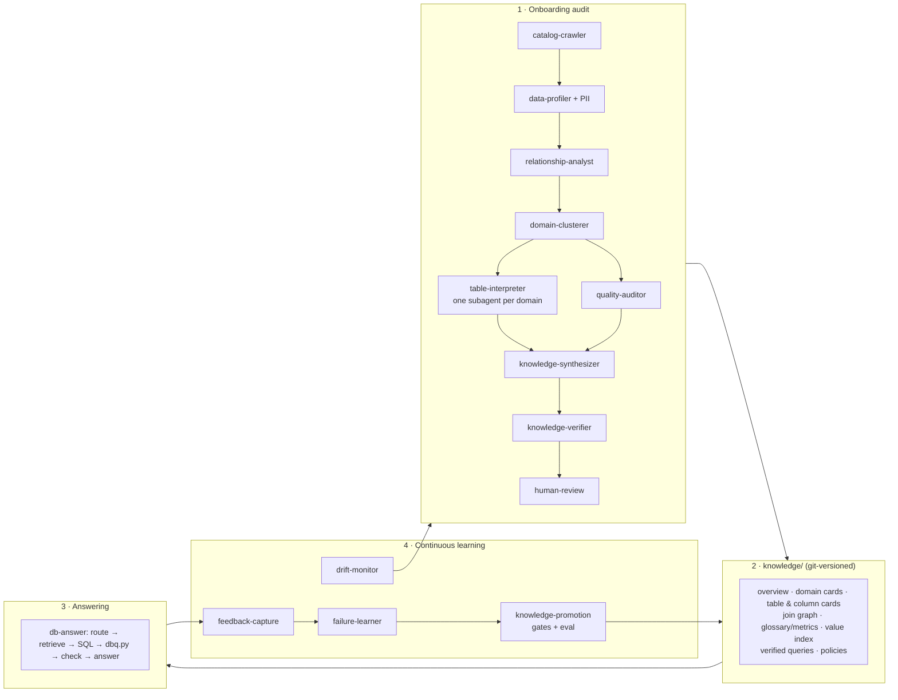

# DB-chatbot

**Turn any AI coding agent into a chatbot for your company database.** It audits your Postgres database once,
writes down what every table means, and then answers business questions with safe, read-only SQL. It keeps
learning from feedback.

Agent-agnostic: the whole system is a set of [Agent Skills](https://agentskills.io) plus one small SQL runner.
It works with **Claude Code, GitHub Copilot (VS Code), OpenAI Codex, Cursor**, or any agent that can read
`AGENTS.md` and run a shell command.

```
you  > What was our net revenue in Munich last quarter?
agent> €184,230 (net of refunds), from 1,912 paid orders.
       SQL: SELECT sum(o.amount - coalesce(r.refunded,0)) / 100.0 ... WHERE s.city = 'Munich' AND ...
       Tables: public.orders, public.refunds, public.stores
       Note: "amount is in EUR cents" was confirmed by your data owner on 2026-10-02.
```

## Why

On real company databases, text-to-SQL rarely fails on SQL syntax. It fails on **missing business context**:
- `amount` is in cents;
- `status = 3` means refunded;
- `orders_old` is dead;
- "clients" means the `accounts` table;
- revenue excludes test customers.

This project treats **the audit and the knowledge it produces as the product**. The chat is the easy part.
The full design is in [`db-chatbot-architecture.md`](db-chatbot-architecture.md).

## How it works



- **Code does the deterministic, safety-critical work.** `shared/dbq.py` enforces read-only access, limits,
  filters and PII masking. The agents do the interpretation.
- **Every fact carries its source and confidence.** The sources are `fk`, `inferred`, `llm_guess`, `verified`
  and `human_confirmed`. The bot tells you when an answer relies on a guess.
- **It learns without retraining.** Failures are diagnosed and turned into proposed knowledge changes. The
  changes are checked against real data and regression-tested on an eval set, and only then committed. It works
  like CI/CD, but for knowledge.

## Two directions, two folders

| folder | what it does |
|---|---|
| [**`audit-your-database/`**](audit-your-database) | connect your database (Supabase, AWS RDS/Aurora, any Postgres; more planned) and run the audit. Output: the audit report in `knowledge/` |
| [**`talk-to-your-database/`**](talk-to-your-database) | connect the agent you already use (Claude Code, Codex, Copilot, Cursor) to the audit report and the database, and ask questions. It learns from your feedback |

## Quickstart

**1. Get the repo** (use a **private** copy per database; see [Privacy](#privacy)).
```bash
git clone https://github.com/adamgdoura6/DB-chatbot.git my-company-db-chat
cd my-company-db-chat
pip install -r requirements.txt
```

**2. Connect and audit** ([details](audit-your-database/README.md)).
```bash
cd audit-your-database
python connect.py           # pick your provider, enter a read-only login, test it
claude --add-dir ..         # or: codex --add-dir ..   then say: "Audit my database"
```
Use a dedicated role that has only `SELECT` on the schemas you want covered
([`readonly-role.sql`](audit-your-database/providers/readonly-role.sql)). Never use an owner or service key.
For example, on Supabase do not use the `service_role` key; it bypasses RLS.

**3. Talk to it** ([details](talk-to-your-database/README.md)).
```bash
cd ../talk-to-your-database
claude --add-dir ..         # or: codex --add-dir ..
```
With Copilot (VS Code) or Cursor, open the repository root and use Agent mode; the root `AGENTS.md` routes the
agent to the right folder.

Then ask: *"How many active customers do we have?"*, *"Where do we store invoices?"*, *"Revenue by month this
year"*. Give feedback in plain words (*"that's wrong, revenue excludes refunds"*).

**4. Let it learn** (nightly, from cron or CI):
```bash
cd talk-to-your-database && claude -p "Follow .agents/skills/db-learn/SKILL.md" --add-dir ..
```

## Repository layout

```
AGENTS.md                         router for every agent: which folder, non-negotiable rules
audit-your-database/
  connect.py                      provider picker + connection and read-only checks, writes .env
  providers/                      per-provider guides, readonly-role.sql
  AGENTS.md, .agents/skills/      the audit skills
talk-to-your-database/
  AGENTS.md, .agents/skills/      the answering and learning skills
knowledge/                        the audit report (written by the audit, read by the chatbot; policies.yaml enforced by dbq)
learning/                         traces, feedback, proposals, eval reports
shared/
  dbq.py                          the only database access path (guarded, read-only)
  skills/                         knowledge-store (file formats), human-review
db-chatbot-architecture.md        the design
```

### Skills

| folder | skills |
|---|---|
| `audit-your-database` | `db-onboarding` (entry point), `catalog-crawler`, `data-profiler`, `relationship-analyst`, `domain-clusterer`, `table-interpreter`, `quality-auditor`, `knowledge-synthesizer`, `knowledge-verifier`, `drift-monitor` |
| `talk-to-your-database` | `db-answer` (entry point), `knowledge-retrieval`, `sql-review`, `feedback-capture`, `db-learn`, `failure-learner`, `knowledge-promotion`, `db-eval` |
| `shared` | `knowledge-store` (file formats, provenance, versioning rules), `human-review` |

## Safety model

Safety is enforced in code, in `shared/dbq.py`, not in prompts:

| protection | how |
|---|---|
| read-only | every statement runs in `BEGIN READ ONLY` with a `statement_timeout`; use a read-only DB role as well |
| SELECT only | parsed with sqlglot: one statement; no writes, DDL, locks, `SELECT INTO` or `EXPLAIN ANALYZE`; dangerous functions blocked (`pg_sleep`, file access, `dblink`, `set_config`, …) |
| restricted data | `blocked_columns` rejected, including via `SELECT *` |
| correct and isolated results | `mandatory_filters` (e.g. soft deletes) and the tenant filter injected into every query |
| load | row cap, timeout, and an `EXPLAIN` cost limit before execution |
| PII | values masked in every output (by column name, value patterns and `pii_columns`) before any model sees them |
| prompt injection via data | the agents have no write tools against the database, and skills treat row content as data |

## Privacy

- `knowledge/` and `learning/` will contain a description of **your** schema and business logic, plus masked
  samples. Keep each database's copy in a **private** repository. Do not open a pull request with them.
- PII is masked before reaching the model, but the schema and aggregate results do reach your agent's model
  provider. Check that this matches your data-processing agreements. For GDPR, use EU-hosted model endpoints if
  needed.

## Status and roadmap

Early stage: Postgres only (including Supabase, RDS and Aurora Postgres).

- [x] Connection helper (`connect.py`) and read-only role script for Supabase, RDS and any Postgres
- [ ] AWS IAM database auth, cross-account IAM, VPC connector
- [ ] Firebase / Firestore (see [providers/firebase.md](audit-your-database/providers/firebase.md))
- [ ] An MCP server version of `dbq` for agents without shell access
- [ ] More engines (MySQL, Snowflake, BigQuery)
- [ ] Pre-built cards for common third-party schemas (Supabase `auth`, Stripe sync, Shopify)
- [ ] Multi-source questions (per-source extractors + DuckDB merge)
- [ ] Example database and end-to-end demo

## Contributing

Contributions are welcome, especially new skills, engine support and real-world gotchas. See
[CONTRIBUTING.md](CONTRIBUTING.md). Report security issues privately (see [SECURITY.md](SECURITY.md)).

## License

[MIT](LICENSE)
