# Database Chatbot: Architecture Summary

**Goal:** A chatbot that answers questions about a company's database. Before chatting, the user grants read access to their database (AWS, Supabase, or elsewhere). A set of agents then audits the database: what each table holds, how tables connect, and where each kind of information lives. The audit is stored as structured knowledge. At query time, the chatbot uses that knowledge to go to the exact location(s) in the database and extract the answer. The system keeps learning and improving after onboarding.

---

## Core design principle

**Let code do everything deterministic. Use LLM agents only for interpretation.**

Much of "understanding a database" is reading the system catalog (`information_schema`, `pg_catalog`). An LLM agent doing that is slower, more expensive, and less reliable than plain code. Agents are for *meaning*: what a table represents, what a column's values mean, which business rules apply.

> On real company databases, text-to-SQL usually fails because of missing business context, not SQL syntax. **The audit phase and the knowledge store are the actual product.** The chatbot is the easy part.

---

## Architecture overview

```mermaid
flowchart LR
  subgraph Onboarding["1. Onboarding audit (once + on change)"]
    A1[Catalog crawler<br/>code] --> A2[Profiler + PII scan<br/>code]
    A2 --> A3[Relationship analyst<br/>code + LLM]
    A3 --> A4[Domain clusterer<br/>code + LLM]
    A4 --> A5[Table interpreters<br/>parallel subagents]
    A4 --> A6[Quality auditor<br/>code + LLM]
    A5 --> A7[Synthesizer<br/>LLM]
    A6 --> A7
    A7 --> A8[Verifier / critic<br/>LLM + SQL]
    A8 --> A9[Human review]
  end

  subgraph Store["2. Knowledge store"]
    S1[DB overview]
    S2[Domain cards]
    S3[Table cards]
    S4[Column cards]
    S5[Join graph]
    S6[Glossary + metrics]
    S7[Value index]
    S8[Verified queries]
    S9[Policies]
  end

  subgraph Query["3. Query time"]
    Q1[Router<br/>small LLM] --> Q2[Context retriever<br/>mostly code]
    Q2 --> Q3[Query agent<br/>strong LLM]
    Q3 --> Q4[SQL guard<br/>code]
    Q4 --> Q5[Execute + check]
    Q5 -- retry max 2-3 --> Q3
    Q5 --> Q6[Answer composer]
  end

  subgraph Learning["4. Continuous learning"]
    L1[Learner agent<br/>offline LLM]
    L2[Promotion gates +<br/>regression runner]
    L3[Drift monitor<br/>code]
  end

  A9 --> Store
  Store --> Q2
  Q6 -- traces + feedback --> L1
  L1 --> L2 --> Store
  L3 -- schema change --> A1
```



---

## 0. Access and security (before any agent runs)

### Supabase
- Do **not** ask for the `service_role` key. It bypasses Row Level Security (RLS) and has write access.
- Give users a script that creates a dedicated read-only Postgres role (e.g. `ai_reader`) with `SELECT` on only the schemas they choose.

### AWS
- Use a **cross-account IAM role with an external ID**.
- Connect to a **read replica** if one exists, so production load isn't affected.
- Many RDS instances sit in **private VPCs** and aren't publicly reachable. You'll need either a small connector the customer deploys inside their VPC (container) or a tunnel (PrivateLink / SSH). This is usually where onboarding breaks, so plan for it early.

### Enforce safety at the database level, not in the prompt
- Read-only transactions
- `statement_timeout`
- Row limits

---

## 1. What the system must learn about a database

| Category | What to capture |
|---|---|
| **Structure** | Schemas, tables, views, materialized views, columns + types, nullability, defaults, primary keys, foreign keys, unique/check constraints, indexes, partitions, enums, sequences, functions/stored procedures, triggers, extensions (e.g. PostGIS, pgvector), RLS policies |
| **Relationships** | Declared FKs; **undeclared relationships** (e.g. `user_id` column with no FK, very common); cardinality (1:1, 1:N, N:M via junction tables); polymorphic relations (`entity_type` + `entity_id`) |
| **Content profile** | Row counts, null %, distinct counts, min/max, top values, distributions, freshness (latest timestamp), growth rate, update frequency, JSONB key structure |
| **Semantics** | Grain (what one row represents); column meaning; **units** (cents vs euros, UTC vs local time, currency); enum decoding (`status = 3` → refunded); which timestamp means what (`created_at` vs `paid_at`); soft deletes (`deleted_at`); test/demo data |
| **Business logic** | Metric definitions ("active user", "revenue": gross or net, refunds excluded?); source of truth when two tables overlap; synonyms ("clients" = `accounts` table) |
| **Quality & hygiene** | Legacy/dead tables (`users_old`, `tmp_*`); orphan rows; duplicates; inconsistent formats; conflicting sources of truth |
| **Sensitivity & access** | PII columns (emails, phones, names, IBANs, health data; GDPR-relevant); tenant columns (`org_id`, `tenant_id`) that must always be filtered; RLS rules |
| **Usage** | `pg_stat_statements` / query logs: which tables are actually used and how they're joined in practice. **The most underrated source**, because real queries reveal true join paths and business logic. |
| **Performance** | Huge tables; which filters hit indexes; partition keys. Needed so the bot never triggers a 10-minute full table scan. |
| **Lineage (optional)** | Which views depend on which tables; ETL pipelines; app code / ORM models / migrations if the customer connects their repo |

---

## 2. Onboarding agents: who does what

**Orchestrator:** a plain code workflow (a DAG, e.g. Temporal, Inngest, LangGraph), **not an LLM**. Each step has typed inputs and outputs.

| # | Component | Type | What it does | Output |
|---|---|---|---|---|
| 1 | **Catalog crawler** | Code | Reads `information_schema` / `pg_catalog` | Raw schema snapshot |
| 2 | **Profiler + PII scanner** | Code | Sampled SQL (e.g. `TABLESAMPLE`) for stats; regex/pattern PII detection; **masks values before any LLM sees them** (order matters for GDPR) | Per-column stats, PII flags, masked samples |
| 3 | **Relationship analyst** | Code + LLM | Starts from declared FKs, proposes undeclared joins from column names and query logs, **verifies each with value-overlap SQL** (inclusion checks) | Join graph with confidence + source per edge |
| 4 | **Domain clusterer** | Code + LLM | Graph community detection on the join graph groups tables into domains (billing, users, inventory…); LLM only names the clusters | Domain assignments |
| 5 | **Table interpreters** | LLM, **parallel subagents** | One subagent per domain (not per table, because a table makes more sense next to its neighbors). Reads schema + profile + masked samples + neighbors. | Table cards + column cards |
| 6 | **Quality auditor** | Code + LLM (runs alongside step 5) | Finds orphans, duplicates, stale/legacy tables; decides canonical vs legacy | Quality flags, gotchas |
| 7 | **Synthesizer** | LLM | Writes domain summaries, a one-page DB overview, and the glossary | L0/L1 cards, glossary |
| 8 | **Verifier / critic** | LLM + SQL | Tests the interpreters' claims against real data (e.g. "status only takes 3 values?"). Generates likely user questions, writes SQL, runs it, keeps working pairs. | Verified query library (also the eval set); list of **open questions** with confidence |
| 9 | **Human review** | Customer | Confirms or corrects low-confidence items (e.g. "Is `amount` in cents?") | Human-confirmed facts |

**Where subagents are used during onboarding:** only at step 5 (and optionally step 8), because that's where work is parallel and independent.

**Refresh strategy:** hash the catalog nightly. On a schema change, re-audit only the affected tables. Refresh stats on a schedule.

---

## 3. Organizing the knowledge (the context store)

### Layered cards, so the bot can zoom from overview to columns
- **L0. Database overview:** one page describing what the business is and listing its domains
- **L1. Domain cards:** the tables in each domain, key entities, common questions
- **L2. Table cards:** purpose, grain, row count, freshness, key columns, joins, gotchas, sensitivity, mandatory filters
- **L3. Column cards:** type, meaning, unit, enum value mapping, null %, sample values (masked), synonyms

### Five side indexes
1. **Join graph:** each edge stores the join condition, cardinality, confidence, and source (FK / inferred / query log)
2. **Glossary + metrics (the semantic layer):** business term → exact SQL definition. Example: *revenue* = `sum(orders.amount_cents)/100 where status = 'paid' and refunded_at is null`
3. **Value index:** distinct values of categorical columns, so "Munich" → `stores.city` and "premium" → `plans.tier`. Without it, the bot can't map user words to `WHERE` clauses. **Exclude PII.**
4. **Verified queries:** question → SQL pairs. Seeded by the verifier, grown from user feedback.
5. **Policies:** blocked columns, mandatory filters (`deleted_at IS NULL`, `org_id = :tenant`), row-level restrictions

### Provenance and confidence on every fact
Each fact records its source (FK-declared / inferred / LLM-guessed / human-confirmed) and a confidence level. Retrieval prefers high-confidence facts, and the bot tells the user when it's relying on a guess.

### Example table card

```yaml
table: public.orders
domain: billing
summary: One row per checkout attempt, incl. failed and refunded
grain: one row per order
stats: {rows: 1.2M, freshness: 2 min}
joins:
  - {to: customers, on: orders.customer_id = customers.id, card: "N:1", source: fk}
  - {to: payments, on: payments.order_id = orders.id, card: "1:N", source: inferred, overlap: 0.98}
columns:
  amount: {meaning: total incl. VAT, unit: EUR cents, confidence: human_confirmed}
  status: {values: {1: pending, 2: paid, 3: refunded}, confidence: verified}
gotchas: ["Exclude internal test customers", "Revenue = status 2 only"]
mandatory_filters: ["deleted_at IS NULL"]
```

### Storage
- **One Postgres with pgvector is enough:**
  - structured JSON per card
  - embeddings for search
  - an edges table for the join graph
- Load the graph into **networkx** in memory for path-finding. Even a few thousand tables is a small graph, so there's no need for Neo4j.
- **Version everything per catalog snapshot.**
- Each card has a structured part (for code) and a prose summary (for embeddings and LLM context).

### Reference formats worth studying
- Snowflake Cortex Analyst semantic model YAML
- dbt semantic layer (MetricFlow)

---

## 4. Query time: who does what

### One extractor or many?
**Use one main query agent by default.** The database is the best join engine available. One correct SQL query with joins beats several agents fetching pieces and stitching them in Python, which adds latency, cost, and compounding errors.

### The pipeline
1. **Router** (small, fast model) classifies the question:
   - *Schema question* ("where do we store invoices?") → answered from the knowledge store with no SQL
   - *Data question* → continue down the pipeline
   - *Ambiguous* → ask a clarifying question
   - *Out of scope* → decline
2. **Context retriever** (mostly code, optional LLM rerank):
   - Runs hybrid search over cards, the value index, and verified queries to find candidate tables.
   - Uses the join graph to find the path connecting those tables (Steiner tree).
   - Assembles a compact context pack.
3. **Query agent** (strong model) with these tools:
   - `search_knowledge(query)` → ranked cards
   - `get_table_card(name)`
   - `find_join_path(tables[])`
   - `lookup_values(text, column?)` → matching real values
   - `get_metric(name)`
   - `run_sql(sql)` (validated, read-only)
   - `ask_user(question)` for clarification

   It can explore before writing the final query, e.g. peek at 5 rows or check that a value exists. For large schemas, letting the agent pull context through tools works better than stuffing everything up front.
4. **SQL guard** (code, not LLM):
   - parses with **sqlglot**
   - rejects anything that isn't a `SELECT`
   - checks column permissions
   - injects tenant/RLS filters
   - adds `LIMIT`
   - runs an `EXPLAIN` cost check
5. **Execute + check:** runs on the replica with a timeout. If the result looks wrong (0 rows, absurd totals, all nulls), it goes back to the query agent with the reason, for at most 2–3 retries.
6. **Answer composer:** returns the answer plus a table or chart, the SQL, and the tables used. Showing the SQL builds trust.
7. **Feedback:** 👍 answers become candidate verified queries; corrections become proposed card updates (see section 6).

### When to spawn subagents at query time (only these cases)
- **Multi-source questions** (e.g. Postgres + S3 files + a second DB): one extractor subagent per source, results merged in a sandbox (**DuckDB**).
- **Truly independent sub-questions** that can't be expressed as one query.
- **Deep analysis mode** ("why did churn spike in March?"): an investigator agent spawns parallel hypothesis checks.

Otherwise, one agent handles it.

---

## 5. Risks and things that will bite

- **Prompt injection through data:** a row value can contain "ignore your instructions." Read-only access plus the SQL guard limits the damage. **Never give an agent that reads raw rows any write tools.**
- **GDPR:**
  - mask PII before it reaches the LLM
  - use EU-hosted model endpoints
  - have a Data Processing Agreement (DPA) ready, since German customers will ask on day one
- **Database load and cost:** profiling huge tables is expensive. Use sampling and timeouts, run on a replica, and schedule off-peak.
- **Small databases** (under ~50 tables): skip retrieval and put the whole compressed schema in context. Build the retrieval layer for when it's actually needed.
- **Evaluation:** the verifier's question → SQL pairs double as the test set. Track execution accuracy per customer.

---

## 6. Continuous learning and improvement

**Key idea:** the system learns by improving its **knowledge store**, not by retraining models. Every failure is diagnosed, turned into a specific knowledge fix, tested, and only then promoted. **CI/CD for knowledge.**

### 6.1 Log every interaction as a trace
Store the question, retrieved cards, SQL, errors and retries, result shape, final answer, and what the user did next.

**Signals to capture:**
- **Explicit:** thumbs up/down, written corrections ("revenue should exclude refunds"), SQL the user edited, answers to clarifying questions
- **Implicit:**
  - user rephrases right away (likely failure)
  - user exports or copies the result (likely success)
  - abandoned session
  - high retry count
  - guard rejections, empty results, slow queries
- **Retrieval:** which retrieved cards were actually used in the final SQL vs ignored. This separates "couldn't find the knowledge" from "the knowledge was wrong."
- **Database-side:** schema changes, new tables, stats drift, new query patterns in `pg_stat_statements`

### 6.2 Learner agent (offline: nightly or hourly, never in the request path)
It reviews failed and corrected traces and classifies the root cause. Each cause needs a different fix:

| Root cause | Fix |
|---|---|
| Unknown term ("clients", "MRR") | Add a synonym or metric to the glossary |
| Wrong meaning (unit, enum, timestamp) | Update the column card, add a gotcha |
| Wrong join | Lower that edge's confidence, add the correct path |
| Right card existed but wasn't retrieved | Improve that card's search text and aliases |
| Wrong metric logic | Add or fix the metric definition |
| Value not found ("Muc" vs "Munich") | Refresh the value index, add an alias |
| Ambiguous question | Add a standard clarifying question for this pattern |
| SQL generation error | Add a verified example, or change the prompt or tools |

The learner does **not** edit the store directly. It writes **proposed changes** to a queue, each with its evidence (trace IDs).

### 6.3 Promotion gates (so it doesn't learn wrong things)
This is the most important part. A system that learns from feedback can also learn mistakes or be fed bad corrections on purpose (poisoning).

- **Trust levels per fact:** `proposed` → `verified` (SQL test passes on real data) → `confirmed` (admin approved, or several users independently agreed). Retrieval ranks confirmed facts higher.
- **One thumbs-up is not proof.** Weight feedback by role: a data owner's correction counts more than a casual user's.
- **Regression tests on every change:** re-run the eval suite before promoting. If accuracy drops, reject the change.
- **Contradiction detection:** if a proposed fact conflicts with a high-confidence one, escalate to a human instead of overwriting.
- **Versioned store with rollback.**
- **Strict per-customer isolation:** one customer's learnings must never leak into another's store.

### 6.4 Staying fresh as the database changes
- Detect schema changes (Postgres event triggers or a nightly catalog hash) and re-audit only the affected tables.
- **Re-run every verified query that touches a changed column.** Broken ones are flagged, not served.
- Refresh stats and the value index on a schedule, since new categories, cities, and product names appear constantly.
- Give every fact a `last_verified` date and re-verify old ones periodically.
- Mine query logs regularly for new join patterns and metric logic.

### 6.5 Ask when unsure, and remember the answer
- Clarifying questions are the cheapest high-quality signal available. When the agent is uncertain ("gross or net revenue?"), it asks, and the answer becomes a **proposed** glossary entry that still goes through the promotion gates.
- Send admins a weekly **knowledge gaps report**: top unresolved questions plus open audit items. A few minutes of their review fixes more than any agent can.

### 6.6 Measuring improvement
- **Every fixed failure becomes a test case,** just as every bug becomes a regression test. The eval set grows from real usage.
- **Metrics to track per customer:**
  - first-answer success rate
  - thumbs-down rate
  - retries per question
  - clarification rate
  - share of questions answered via verified queries
  - latency and cost per answer
- Test any prompt or model change against the eval set before rolling it out.

### 6.7 Learning across customers (product level)
Customer data can't be shared, but patterns can:
- **Schema templates:** many databases contain the same third-party schemas (Supabase `auth.users`, Stripe sync tables, Shopify exports). Pre-built cards make onboarding instant and are already correct.
- **Aggregate failure statistics:** anonymized root-cause counts show which prompts and tools to improve product-wide.
- **Later, fine-tuning:** once there are thousands of verified question → SQL pairs, with customer consent, fine-tune small models for routing and schema linking to cut cost and latency.

### 6.8 Components added by the learning loop
- **Learner agent** (LLM, offline)
- **Regression runner** (code)
- **Drift monitor** (code)
- A feedback path from the answer composer back into the knowledge store, passing through the promotion gates

---

## Full component list

| Phase | Component | Type |
|---|---|---|
| Access | Read-only role / IAM role / VPC connector | Infra |
| Onboarding | Workflow orchestrator (DAG) | Code |
| Onboarding | Catalog crawler | Code |
| Onboarding | Profiler + PII scanner | Code |
| Onboarding | Relationship analyst | Code + LLM |
| Onboarding | Domain clusterer | Code + LLM |
| Onboarding | Table interpreters (parallel subagents per domain) | LLM |
| Onboarding | Quality auditor | Code + LLM |
| Onboarding | Synthesizer | LLM |
| Onboarding | Verifier / critic | LLM + SQL |
| Onboarding | Human review UI | Customer |
| Store | Cards (L0–L3), join graph, glossary/metrics, value index, verified queries, policies | Postgres + pgvector |
| Query | Router | Small LLM |
| Query | Context retriever | Mostly code |
| Query | Query agent (with tools) | Strong LLM |
| Query | SQL guard | Code (sqlglot) |
| Query | Executor + result checker | Code + LLM |
| Query | Answer composer | LLM |
| Query (optional) | Per-source extractor subagents + DuckDB merge | LLM + code |
| Learning | Trace logger | Code |
| Learning | Learner agent | LLM (offline) |
| Learning | Promotion gates + regression runner | Code |
| Learning | Drift monitor | Code |

---

## Suggested next step
Prototype the **catalog crawler, profiler, and relationship analyst** against a real Supabase project, then look at what the generated cards look like on real data before building the query side.
